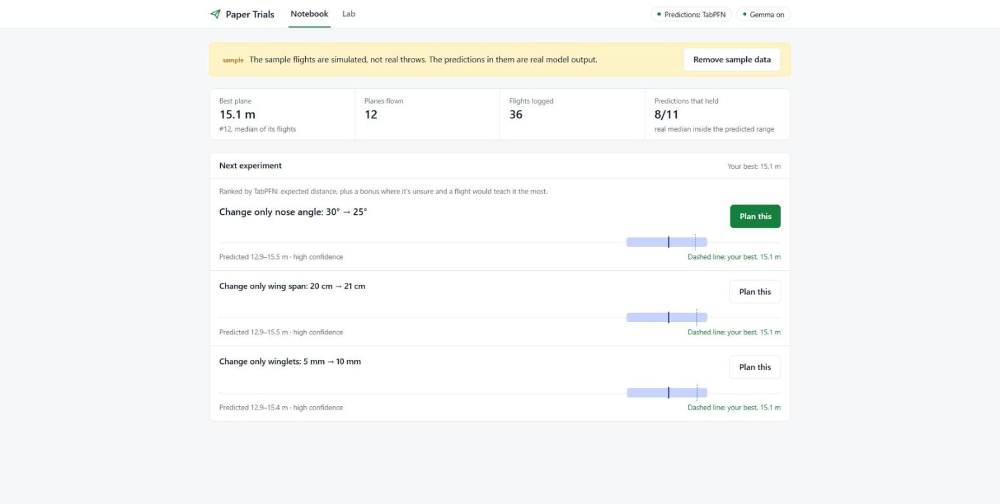
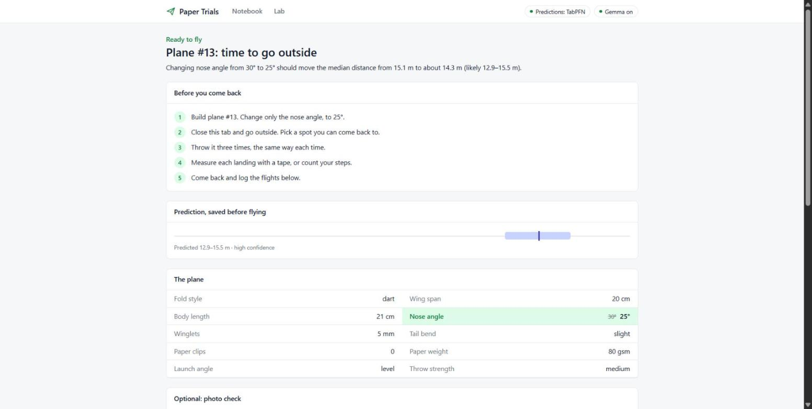
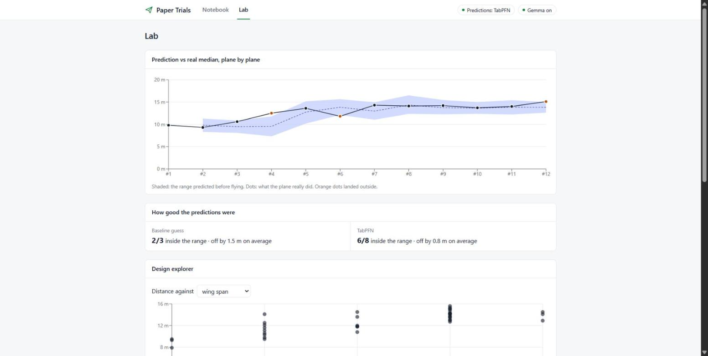

# Paper Trials

A lab notebook for paper airplanes. You change one thing about a plane, take it outside, throw it a few
times, and write down how far it went. The app predicts the result before you fly, keeps that prediction
fixed, and uses every flight you log to suggest the next change.

Most of the time you spend with it is spent away from the screen, folding paper and walking to where
the plane landed.



## Why paper airplanes

A paper plane is about the cheapest real experiment you can run. One sheet of paper, a few seconds to
fold, a few seconds to fly, and a tape measure (or your steps) to measure it. It's also noisy enough to be
honest about: two throws of the same plane can land metres apart because of the wind, your arm, or a
crooked fold. That makes it a good place to practise the habits that matter in any experiment:

- change one thing at a time, so you know what made the difference
- write the prediction down before you look at the result
- repeat each test and look at the median, not your best throw
- check whether your predictions were any good

## How the loop works

```
   plan one change ──► prediction saved (can't be edited later)
          ▲                      │
          │                      ▼
  next suggestion        build it, go outside,
  (TabPFN + rules)       throw it 3 times, measure
          ▲                      │
          │                      ▼
   model learns  ◄──── log the flights, Gemma reads your notes
                       and writes a short lab note
```

1. **Plan.** The notebook suggests up to three changes, each one step away from your best plane so far
   ("Change only the wing span: 20 cm → 21 cm"). You can also plan your own.
2. **Predict.** When you save the plan, the app predicts the median distance with a range (the 10th to 90th
   percentile) and stores it. It's never recalculated, so the comparison with what really happens stays
   fair.
3. **Fly.** Test mode tells you exactly what to build and asks you to close the tab and go outside.
4. **Log.** Back inside, enter each throw's distance (in metres or steps), and optionally the time in the
   air, how steady it was, the wind, and a short note like "climbed, stalled, then veered left".
5. **Learn.** The flights join the training data and the next suggestion is ranked by the updated model.



## What the models do

### TabPFN predicts distances

[TabPFN](https://github.com/PriorLabs/TabPFN) is a model pretrained to make predictions from small tables.
It doesn't need training in the usual sense. You hand it your flights as rows and it predicts in one
forward pass. That suits this app: after a week you might have forty flights, far too few for most models.

Every flight is a row with the plane's design, how it was thrown, and the wind. The target is the distance.
For a new plane, TabPFN returns the 10th, 50th and 90th percentiles, which become the predicted range.

Until there are at least 4 flown planes and 8 flights, a simple nearest-neighbour guess is used instead, and
the app says so. Its range gets wider the further a new plane is from anything you've flown.

The app uses the TabPFN v2 weights because they download without an account. Newer versions need a
browser licence login first.

### Picking the next experiment

The suggestion isn't generated by a language model. It's plain code:

1. Start from your best plane (highest median distance).
2. Try every single-step change to one setting (one more paper clip, 1 cm wider, 5° sharper...), skipping
   anything you've already built.
3. Score each one by its predicted median, plus a bonus for a wide range. A plane the model is unsure about
   teaches it the most, so it's worth a flight even if it isn't the favourite.
4. If your notes keep mentioning the same problem, changes known to address it get a bonus too. Stalls
   suggest a paper clip on the nose or less tail bend; nose dives suggest the opposite.

Before TabPFN takes over, it steps through wing span, nose angle, tail bend and paper clips one at a time,
so the first few flights cover the basics.

### Gemma reads notes and writes the lab note

[Gemma 3](https://ai.google.dev/gemma) (4B, through [Ollama](https://ollama.com)) has three small jobs, all
on your computer:

- **Reading flight notes.** "Climbed then dropped, pulled left" becomes the tags `stall` and `veer_left`,
  which the recommender uses.
- **Writing a two-sentence lab note** after each experiment, from numbers the code has already worked out.
  The note is thrown away and replaced by a plain template if it contains a number that isn't in the
  facts, gets the direction of the change wrong, claims the result was inside the range when it wasn't,
  mentions a problem nobody reported, or guesses at a cause. Small models do all of these; the checks are
  there because they were caught doing it.
- **Checking a photo** of the plane for uneven wings before you throw. It's shown as an estimate with a
  confidence and never fed to the prediction model. The photo isn't saved.

Without Ollama the app still works: notes are tagged by keyword matching and lab notes use the template.

## The Lab

The Lab plots every frozen prediction against what the plane really did, scores each model on how often
the real median landed inside its range, and lets you plot every throw against one design setting.



## Running it

You need Python 3.11+ with [uv](https://docs.astral.sh/uv/), and Node.js 22.12 or newer. Ollama is optional.

```
git clone https://github.com/Surge77/paper-trials.git
cd paper-trials

cd frontend
npm ci
npm run build

cd ../backend
uv sync
uv run papertrials
```

Open http://127.0.0.1:8000. The first prediction made by TabPFN downloads its weights once, which takes a
moment. `uv sync` installs the CPU build of PyTorch, which is a large download.

For the Gemma features:

```
ollama pull gemma3:4b
```

To try the app before flying anything, press **Look around with sample data**. Remove it with one button
when you're ready to start your own notebook.

### Using it from your phone

The app only listens on your own computer by default. To log flights from a phone on the same Wi-Fi, start
it with `PAPERTRIALS_HOST=0.0.0.0 uv run papertrials` and open `http://<your computer's IP>:8000`. There's
no login, so only do this on a network you trust.

### Settings

Environment variables (or a `.env` file in `backend/`):

| Variable | Default | |
|---|---|---|
| `PAPERTRIALS_DB_PATH` | `papertrials.db` | SQLite file for your notebook |
| `PAPERTRIALS_OLLAMA_URL` | `http://127.0.0.1:11434` | |
| `PAPERTRIALS_GEMMA_MODEL` | `gemma3:4b` | the photo check needs a model that accepts images |
| `PAPERTRIALS_USE_TABPFN` | `true` | `false` keeps the simple baseline (for slow machines) |
| `PAPERTRIALS_HOST` / `PAPERTRIALS_PORT` | `127.0.0.1` / `8000` | |

## About the sample data

The sample notebook is **simulated**. A made-up formula decides how far each design "wants" to fly, then
random noise and wind are added ([`make_demo_data.py`](backend/scripts/make_demo_data.py)). Nobody threw
those planes. What is real: each sample experiment was planned by the app's own recommender, and its
prediction was made by the app's own models using only the flights before it, so the prediction chart is
an honest replay. Every sample row is labelled in the app.

## Limitations

- **Three throws is a small sample.** Wind and your arm can move the median more than a design change does.
  The predicted range tries to show that, and the app never calls a result proven.
- **It learns your planes, your arm and your park.** Predictions don't transfer to someone else's throws.
- **Single-step changes find local improvements.** It won't jump from a dart to a glider on its own; plan
  that yourself.
- **The issue-to-fix rules are rules of thumb** (a stall suggests more nose weight), not physics.
- **The photo check is a rough estimate** from a 4B model, and is labelled as one.

## Development

```
cd backend
uv run pytest              # fast tests; Ollama and TabPFN are stubbed
uv run pytest -m slow      # also loads the real TabPFN model
uv run pyright

cd frontend
npm test
npm run typecheck
npm run dev                # Vite on :5173, proxies /api to the backend on :8000
```

Run the backend with reload while working on it: `uv run uvicorn papertrials.main:app --reload`.

Every design variable is defined once in [`fields.py`](backend/src/papertrials/fields.py). The database
columns, the model features, the form in the browser and the steps the recommender can take all come from
that list, so adding a variable means adding one entry there and one column in `models.py`. There are
no migrations, so an existing `papertrials.db` won't get the new column; delete it or add the column by
hand.

## Credits

- Built with PriorLabs-TabPFN. TabPFN v2 weights are under the
  [Prior Labs License](https://github.com/PriorLabs/TabPFN/blob/main/LICENSE).
- [Gemma 3](https://ai.google.dev/gemma) by Google, run locally through [Ollama](https://ollama.com).
- [FastAPI](https://fastapi.tiangolo.com), [SQLModel](https://sqlmodel.tiangolo.com),
  [React](https://react.dev), [Vite](https://vite.dev), [Tailwind CSS](https://tailwindcss.com) and
  [Recharts](https://recharts.org).

## License

[MIT](LICENSE)
